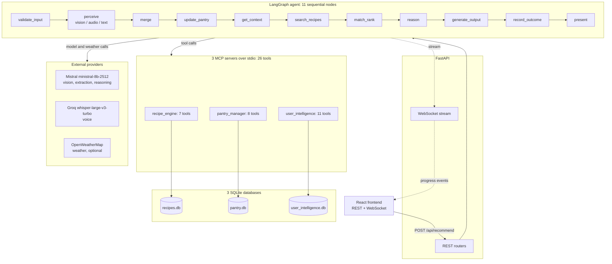

# MealSight

[](https://github.com/RudeDude7/Meal-Sight/actions/workflows/ci.yml)
[](https://github.com/RudeDude7/Meal-Sight/actions/workflows/eval-full.yml)

A meal recommender: send a photo of your fridge, a voice memo or text, and it suggests something you can cook with what you have. It is a single-user portfolio project built on free-tier APIs, with a five-dimension evaluation suite.

> **Status:** four of the five evaluation dimensions pass. Dimension 1 (ingredient recognition from photos) fails at 0.488 against its 0.60 threshold, so the suite reports **FAIL overall**. The benchmarked vision model was retired by the provider mid-project and the medium tier became unavailable on the free plan. The threshold was kept, not lowered to match. See [Evaluation](#evaluation).

<!-- SCREENSHOT PLACEHOLDER: the Home page mid-run (pipeline steps plus the live feed). Add when captured. -->

## What it does

An 11-node agent reads what you sent, updates the pantry, searches a 250-recipe corpus, scores each recipe against what you have, and picks one. When nothing is cookable it says so instead of inventing something.

**A real recommendation** (photo of a fridge plus "What can I cook for dinner tonight? Something light."; 14 items identified, 10 candidates considered):

> Kumpir is the best available match. The closest alternative was Boulangère Potatoes.

**A real refusal** ("I only have 15 minutes, what can I make?" against the demo pantry):

> None of the top candidates are actually cookable with what's on hand right now. The closest is Moussaka (ingredient match 0.4625), missing: eggplant, greek yogurt, egg, parmesan. Buy those, or relax the cook-time/cuisine constraints to find something that better matches what's already available.

Refusal is the common state with a sparse pantry. The evaluation counts a correct refusal as a pass and a wrongly refused satisfiable request as a failure.

## Architecture



Three perception modalities feed one agent: photos go to the vision model, voice memos to Whisper, and text to an extraction model that pulls out ingredients, dietary restrictions and avoid lists. The agent reaches recipe, pantry and user data through the MCP servers, and progress streams to a React 18 + TypeScript + Vite frontend over a WebSocket.

## How a run works

`POST /api/recommend` returns a session id; the client subscribes to `/ws/{session_id}`. A real photo-plus-text trace, condensed (offsets from the POST, 65 messages in all):

```
+ 0.09s  node_start       perceive
+ 0.09s  ingredient_found Analyzing your photo...  /  Reading your request...
+ 2.57s  ingredient_found Waiting for the rate limit, not computing: the free tier allows 2 requests a minute (one every 30s). About 28s to go.
+ 9.93s  ingredient_found Found 14 item(s) in your photo.
+31.45s  node_complete    perceive
+31.5s   merge, update_pantry, get_context, search_recipes, match_rank (10 recipe_match events, 0.5 s in total)
+31.90s  node_start       reason
+34.40s  node_start       Waiting for the rate limit ... About 26s to go.     (every 2.5 s, counting down)
+61.92s  node_start       Asking the model to weigh the candidates against your pantry, history and context.
+64.21s  recommendation   Kumpir is the best available match...
+64.32s  complete                                                     total 64.3 s, longest gap 2.51 s
```

Nearly all of the 64 seconds is rate-limit waiting (in an earlier run of the same flow: 58.5 s waiting, 7.8 s API time).

## Evaluation

Five dimensions, 150 cases. Thresholds were fixed before each dimension's first run and never changed. Expected answers were derived by hand before running the system (later corrections are dated and documented). Dimensions 4 and 5 run on throwaway databases, with the real ones hashed before and after.

| # | Dimension | Cases | Score | Threshold | Result |
|---|---|---|---|---|---|
| 1 | Ingredient recognition from photos | 30 | 0.488 (F1) | 0.60 | **FAIL** |
| 2 | Constraint satisfaction | 55 | 1.000 | 1.00 hard, 0.50 soft | PASS |
| 3 | Match accuracy (no model calls) | 32 | 1.000 | 1.00 | PASS |
| 4 | Freshness prioritization | 15 | 0.933 | 0.80 | PASS |
| 5 | Personalization | 18 | 1.000 | 0.80 | PASS |

**Why Dimension 1 fails.** The 0.60 threshold was set against `mistral-medium-2505` (mean F1 0.64). Mistral retired that model and the medium tier is unavailable on this account's free plan. The best reachable replacement, `ministral-8b-2512`, scores about 0.49 to 0.55 depending on the scorer, and a prompt comparison showed the gap is the model tier, not the wording. Caveats, including that Dimension 2 was re-baselined after its first run (20/30), are in [docs/EVALUATION.md](docs/EVALUATION.md).

CI gates on **regression** against a committed baseline, not on the overall verdict, which would be permanently red. A dimension below its recorded level, or a broken safety invariant, fails. Dimension 3 runs on every pull request ([docs/CI.md](docs/CI.md)).

## Bugs the evaluation found

Each passed its unit tests: the code was correct and was never called correctly, or with the wrong data.

| Bug | Found by | What it would have caused |
|---|---|---|
| Avoid lists were unenforced (prompt text only) | Dimension 2 | A nut dish served to a nut-free request if the model ignored a prompt line |
| `match_rank` discarded dietary restrictions | Dimension 3 | Greek yogurt offered to a dairy-free user as a mayonnaise substitute |
| Untagged restrictions were dead filters (12 of 17) | Dimension 2 audit | Requests like peanut-free matched zero recipes and were refused, not protected |
| Saved profile restrictions ignored entirely | Dimension 5 | A vegetarian profile was served salmon; a saved nut allergy would have been dropped too |
| Cuisine learning dead in production (case mismatch: `Italian` looked up as `italian`) | Dimension 5 | Learned cuisine preferences never changed a ranking outside tests |
| Nutrition about 4x too high (scaled after dividing by servings) | Evaluation work | Per-serving figures roughly four times too high |
| Reasoning made unsupported claims in 7 of 10 runs | Manual faithfulness check ([VISION_FINDINGS §7](docs/VISION_FINDINGS.md)) | Pantry items attributed to recipes that lack them ("uses chicken"; it has none) |
| MCP subprocesses did not inherit the environment | First clean-checkout CI run | Servers fail to start when keys come from real environment variables (CI, Docker); a local `.env` hid it |
| Rate limiter blocked finished calls behind another call's wait | Real WebSocket trace | A photo result ready at about 9 s arrived at about 30 s |
| "garlic clove" did not match "garlic" | Dimension 3 | 25 of 250 recipes under-scored a pantry holding garlic |
| "stock cube" did not match "stock" | Dimension 3 | Stock cubes could not satisfy a recipe needing stock (`can_cook` false) |

## Engineering decisions worth explaining

- **Factual reasoning is rendered from data, not written by the model.** A check of 10 real recommendations found an unsupported factual claim in 7. The failures were in what the model synthesized, never in what it quoted, so ingredient match, freshness, nutrition and context are now composed deterministically from the match data. I did not re-run the check afterwards and make no claim about the new rate. See `backend/mealsight/agent/reasoning_facts.py`.
- **Nutritional restrictions are disclosed, not enforced.** The nutrition estimates are too unreliable to filter on (a baked-potato dish at 13 g carbohydrate per serving, a tomato soup at 241 g). `low-carb`, `keto`, `low-sodium` and `low-fat` get an explicit "NOT ENFORCED" statement instead of a filter that would look authoritative and be wrong. Allergen and ingredient-based diets are enforced against ingredient lists.
- **The provider layer survived a model retirement.** Model ids live in settings behind one abstraction, so the swap was mostly configuration plus re-measurement (which also exposed a scorer defect and a parsing defect, both fixed).
- **Honest refusal is designed behavior.** "Nothing is cookable" names the closest recipe and what is missing, and passes the evaluation when correct.

## Operating characteristics

- **About 64 seconds per photo recommendation** (three real WebSocket runs: 62 to 64 s), nearly all of it rate-limit waiting. Mistral cut its free tier mid-project: `ministral-8b-2512` now allows **2 requests and 40,000 tokens per minute**, measured from live response headers (it was 3.13 requests per second and 625,000 tokens per minute at the start). Text-only takes about 33 s. That is a demo, not an interactive tool; a paid tier removes the wait. Re-verify with `python -m eval.preflight` rather than trusting numbers written here.
- **The UI never goes silent for long.** Provider-calling stages send a progress line every 2.5 s, a countdown while queued behind the limiter. The longest gap in the trace was 2.51 s.
- **Cost:** a full evaluation run is about 426,000 tokens, roughly 4 cents against a $10 monthly allowance (the account's figure) with pay-as-you-go disabled, so the project cannot incur charges. Throughput, not tokens, is the constraint.

## Limitations and known gaps

- Single user by design: no authentication, one pantry, one profile, one default weather location.
- The demo pantry is thin: 22 of 250 recipes are cookable, so refusals are common and passes speak to this pantry only.
- Dimension 1 fails and will until a stronger vision model is reachable.
- The full evaluation cannot complete on the current rate limit, so it is manual-only (`eval-full.yml`). Dimension 3 still gates every PR.
- The reasoning step can override a correct freshness ranking (`d4_13` fails in every run).
- `cooking_skill` and `budget_sensitivity` have no code effect; they reach the model only as prompt text.
- Nutritional restrictions are disclosed, not enforced. Halal and kosher are partial: slaughter and certification cannot be verified.
- More in [docs/KNOWN_ISSUES.md](docs/KNOWN_ISSUES.md).

**Multi-user would need**, as future work and not a plan: authentication and per-user data isolation, a database that handles concurrent writers, per-user locations, and a provider plan above one request every 30 seconds.

## Setup

**Prerequisites:** [uv](https://docs.astral.sh/uv/) (fetches the pinned Python 3.11) and Node 20.

**API keys** (copy `.env.example` to `.env` in this folder):

| Key | Where to get it | Needed for |
|---|---|---|
| `MISTRAL_API_KEY` | console.mistral.ai | vision, extraction, reasoning (required) |
| `GROQ_API_KEY` | console.groq.com | voice transcription (required to start) |
| `OPENWEATHER_API_KEY` | openweathermap.org | weather context (optional; the system degrades silently without it) |

**Backend**

```bash
cd backend
uv sync
# Build the databases offline from the pinned recipe snapshot (or `uv run mealsight-seed` to fetch live from TheMealDB)
uv run python -m mealsight.seed.seed_all --from-snapshot
# Seed the demo pantry (64 rows) from test_data/demo_pantry.json
PYTHONPATH=. uv run python ../scripts/reset_demo_pantry.py
uv run uvicorn mealsight.api.app:app --port 8000
```

**Frontend** (second terminal; the dev server proxies `/api` and `/ws` to port 8000)

```bash
cd frontend
npm ci
npm run dev        # http://localhost:5173
```

**Tests and checks**

```bash
cd backend
uv run ruff check . && uv run mypy --strict mealsight eval && uv run pytest
cd ../frontend && npm run typecheck && npm run lint && npm run build
```

**Evaluation**

```bash
cd backend
PYTHONPATH=. uv run python -m eval dimension3     # free, under a second; needs the three env vars set, placeholders are fine
PYTHONPATH=. uv run python -m eval.preflight      # one call per provider; prints the live rate limits
PYTHONPATH=. uv run python -m eval                # all five: real API calls, about an hour at the current rate limit
```

Scorecards land in `backend/eval/results/`; compare one with the baseline via `python -m eval.compare <scorecard>`.

## Tech stack

Python 3.11, FastAPI, LangGraph, FastMCP, SQLite (aiosqlite), Pydantic; React 18, TypeScript, Vite, Tailwind; Mistral, Groq, OpenWeatherMap, TheMealDB (recipe corpus); uv, ruff, mypy `--strict`, pytest (977 tests), GitHub Actions.

## More detail

| Document | What is in it |
|---|---|
| [docs/EVALUATION.md](docs/EVALUATION.md) | Methodology, full results, caveats, every bug found |
| [docs/CI.md](docs/CI.md) | Pipeline, regression gate, preflight, rate-limit impact |
| [docs/VISION_FINDINGS.md](docs/VISION_FINDINGS.md) | Vision model choice, the retirement, the faithfulness check |
| [docs/vision_benchmark_report.md](docs/vision_benchmark_report.md), [docs/vision_diagnostic_report.md](docs/vision_diagnostic_report.md) | The original vision benchmark and diagnostics |
| [docs/KNOWN_ISSUES.md](docs/KNOWN_ISSUES.md) | Deferred findings |
| [backend/eval/README.md](backend/eval/README.md) | Log of every evaluation run and correction |
